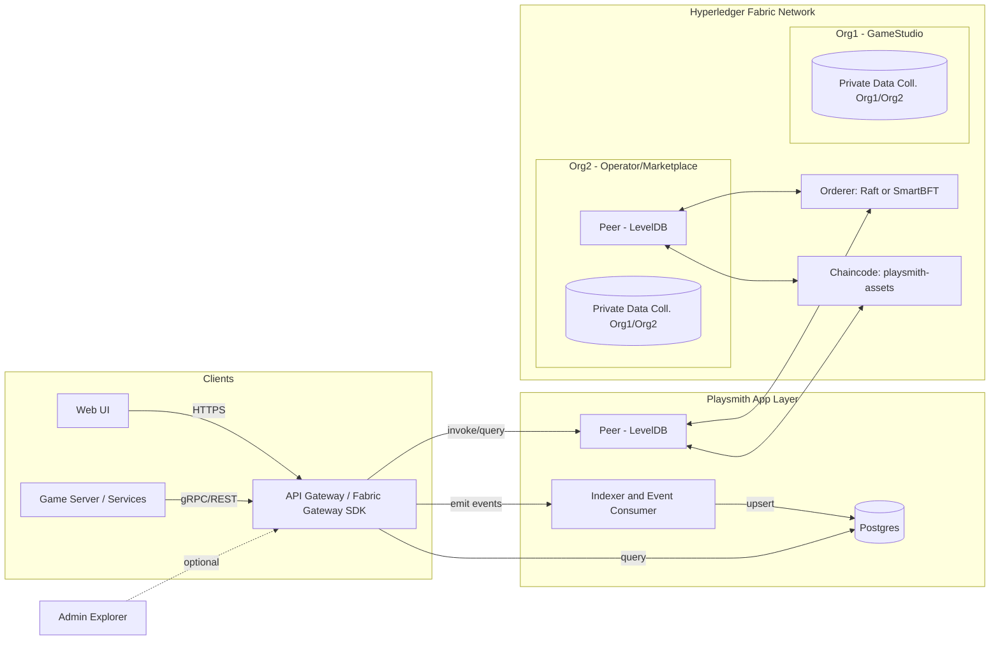

# Playsmith

A permissioned, high-performance blockchain stack for game asset minting, trading, and querying, built on Hyperledger Fabric.

Chinese version: [README.zh.md](README.zh.md)

Goals
- On-ledger game assets: fungible / semi-fungible / non-fungible (ERC-1155 style) minting, transfer, listing and trading
- Web browsing: browse/search pages and asset detail pages, event-driven indexing
- Game-friendly interfaces: REST/gRPC SDK plus batch endpoints for game servers
- Performance: second-level finality and a few hundred to a thousand TPS in steady state; a key space designed to avoid hotspot conflicts

## Architecture (Mermaid)

Notes
- API Gateway: exposes REST/gRPC externally; calls chaincode internally through the Fabric Gateway SDK; centralizes authentication, rate limiting and batching.
- Indexer: subscribes to chaincode events and builds browsable views in Postgres (for Web/UI and statistics); avoids expensive rich queries against the ledger.
- Fabric: 2 organizations, 1 channel; Raft/SmartBFT ordering; peers on LevelDB (high throughput); sensitive fields (price, counterparty, settlement evidence) can live in a private data collection.

## Ledger and chaincode design (1155 style)
Key space (composite keys, to avoid hotspots)
- `bal~tokenId~owner -> uint64`: balance
- `meta~tokenId -> {uri, creator, supplyCap...}`: metadata
- `op~owner~operator -> bool`: approval (optional)
- `ask~tokenId~seller~listingId -> {amount, price, ts}`: listing (price can move to private data)

Main transactions
- `Mint(tokenId, to, uri, amount)`: only `role=MINTER` may mint; writes `meta` on first mint
- `Transfer(tokenId, from, to, amount)`: checks approval and balance, mutates `bal` atomically
- `ListForSale(tokenId, seller, amount, price)`: writes `ask`; production can keep the price in a private collection
- `Buy(tokenId, seller, listingId, buyer, amount)`: transfers atomically and deletes `ask`

Concurrency and performance
- A transaction touches very few keys (seller/buyer balance + the listing), keeping MVCC conflict probability low
- No global counters; `listingId` uses the TxID or a server-generated UUID

## API design (game friendly)
Authentication
- Two models are supported:
  - Platform-hosted: the platform issues JWTs to game servers (bound to Fabric identity in the backend)
  - Self-held certificate: the game server uses an X.509 certificate from Fabric CA and connects through the Gateway

Implementation (`internal/auth`)
- Platform-hosted (HS256): `POST /api/v1/auth/token` (with `X-Issue-Secret`) issues a JWT; both REST and gRPC require `Authorization: Bearer <jwt>`
- Per-operation authorization: every authenticated call must carry a non-empty `mspId` and `role` in the JWT; `Mint`/`BatchMint` additionally require `role=MINTER` (gateway-level gate, same rule as the chaincode `requireMinter`; `internal/auth/authorize.go`)
- Gateway Fabric identity: `FABRIC_CERT_PATH`/`FABRIC_KEY_PATH`/`FABRIC_MSP_ID` configure the X.509 identity the gateway process submits with (every caller currently shares that one identity; per-subject identity isolation is pending, see `todo.md`); REST stays open when JWT is disabled (dev mode)
- Transport security: with `TLS_CERT_PATH`/`TLS_KEY_PATH` (PEM cert/key) set, REST and gRPC are both served over TLS; when unset both fall back to plaintext (dev only)

REST (implemented endpoints; fields in `docs/SPEC.md` API Mapping)
- `POST /api/v1/assets/mint` body: `{tokenId, to, uri, amount}` (JWT needs `role=MINTER`)
- `POST /api/v1/assets/batchMint` body: `{ids, tos, amounts, uris}` (JWT needs `role=MINTER`)
- `POST /api/v1/assets/transfer` body: `{tokenId, from, to, amount}`
- `POST /api/v1/assets/batchTransfer` body: `{ids, from, to, amounts}`
- `POST /api/v1/assets/approveAll` body: `{owner, operator, approved}`
- `GET /api/v1/assets/:tokenId/balance/:owner`, `/:tokenId/uri`, `/:tokenId/exists`, `/:tokenId/totalSupply`
- `POST /api/v1/market/list` body: `{tokenId, seller, amount, price}`
- `POST /api/v1/market/list-private` body: `{tokenId, seller, amount, price}` (price sent via transient)
- `POST /api/v1/market/cancel` body: `{tokenId, seller, listingId}`
- `POST /api/v1/market/buy` body: `{tokenId, seller, listingId, buyer, amount}`
- Listing/trade browsing queries are planned: they would sit over the indexer's Postgres projection, together with the query API and the Web UI

gRPC (optional)
- Same service definition, returning the transaction result and `tx_id` (the on-ledger transaction identifier, available even when the chaincode returns no value); lower overhead, suited to high-concurrency backends. Block numbers and event receipts are planned; the current proto response carries only `tx_id`/`result`.
- Enable by setting `GRPC_PORT` (and `JWT_SECRET`, otherwise it refuses to start); proto in `proto/playsmith/v1/gateway.proto`

Web UI
- Browses contract events, asset balances, recent trades and listings; queries read the indexed views in Postgres.

## Quick start (development)
Prerequisites
- Docker & Docker Compose, Node.js or Go, Fabric v2.5+ binaries
- Clone `hyperledger/fabric-samples` (network scripts)

Steps (using test-network)
1) Bring up 2 organizations and 1 channel
   - `cd fabric-samples/test-network`
   - `./network.sh up createChannel -c playsmith -ca`  # development; LevelDB (the default) is recommended for production
2) Deploy the chaincode
   - `./network.sh deployCC -c playsmith -ccn playsmith-assets -ccl go -ccp ../../Playsmith/chaincode/playsmith-assets`
3) Start the application layer
   - API: `cmd/api` (Go; uses the real Fabric Gateway client when `FABRIC_GATEWAY_ENDPOINT` and related variables are set, and falls back to `NoopClient` dev mode otherwise)
   - Auth: `JWT_SECRET` (≥32 bytes) enables JWT; `POST /api/v1/auth/token` needs `X-Issue-Secret` equal to `JWT_SECRET`; gRPC port via `GRPC_PORT`
   - Indexer: `cmd/indexer` (subscribes to chaincode events and upserts into Postgres; needs `POSTGRES_DSN` and the Fabric variables)
   - Web UI: `web/` (placeholder for now; query pages pending)
4) Build and test
   - `make build` / `make test` (both run the `proto-check` generated-code guard first); regenerate with `make proto` (the protoc version is pinned in the Makefile, and `make proto-install` installs the plugins and verifies the toolchain)

Repository layout
- `chaincode/playsmith-assets/`: chaincode (Go; implements Mint/Transfer/Batch/List/Buy/Cancel/approvals/supply/private price)
- `cmd/api/`: API Gateway (REST + batch; JWT auth and gRPC implemented)
- `cmd/indexer/`: event subscription and persistence (Fabric Gateway events + Postgres)
- `internal/sdk/`: Fabric SDK wrapper (`Client` interface + `NoopClient` dev placeholder + `GatewayClient` real implementation)
- `web/`: frontend (query pages, placeholder)
- `deploy/`: local one-shot scripts and Docker compose

## Performance and tuning
Fabric layer
- Orderer: `BatchTimeout=0.5-1s`, `MaxMessageCount=200-500`, `AbsoluteMaxBytes/PreferredMaxBytes` tuned to network bandwidth
- Peer: parallel endorsement on; raise GOMAXPROCS and the connection pool; LevelDB > CouchDB (when rich queries are not needed)
- Chaincode: avoid hot keys; minimize the read/write set; prefer composite-key prefix scans over rich queries

Application layer
- Batched submission (client/gateway aggregation) and idempotent retries (deduplicated by TxID)
- The indexer rebuilds views asynchronously so Web queries never trigger expensive ledger scans
- A low-latency gRPC pipeline instead of REST (optional)

Targets (conservative)
- Simple transfer/trade path: 200-800 TPS (2-4 nodes, 1s batching, LevelDB)
- Second-level finality: 0.8-2.5s end to end is typical (depending on batching and endorsement)

## Permissions and privacy
- Organization identity (MSP/CA); minting checks the certificate attribute `role=MINTER`; operator approval uses ledger state `op~owner~operator`, not a certificate attribute
- Endorsement policy: `AND('Org1.peer','Org2.peer')`; asset-level SBE can tighten it further
- Private data collection: prices, counterparties and settlement details are visible only to Org1/Org2; the ledger stores a hash for verification

## Roadmap
- [x] Chaincode v0: Mint/Transfer/List/Buy + events (also BatchMint/BatchTransfer/approvals/supply/private-price listings; authorization checks implemented, see `docs/SPEC.md`)
- [x] API Gateway (REST + batch; Fabric calls can switch to the real `GatewayClient`, defaulting to `NoopClient` dev mode)
- [x] API Gateway: JWT auth and gRPC
- [x] Indexer (subscribes to Fabric events) + Postgres schema
- [x] Fabric Gateway SDK integration (replaces the `internal/sdk` NoopClient)
- [ ] Web UI (assets/listings/trades)
- [ ] Load test scripts (Caliper or in-house) and tuning templates
- [x] `playsmithPvt` collection config file (`deploy/collections.json`)
- [ ] SBE (asset-level endorsement policy) sample

## License
This project follows the LICENSE of this repository.
