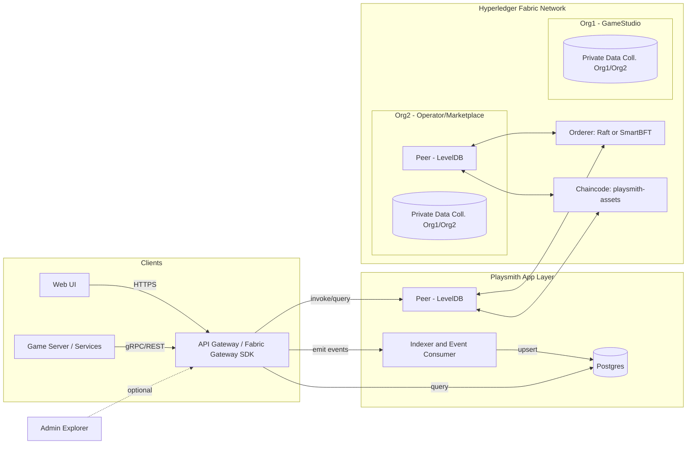

# Playsmith

A permissioned, high-performance blockchain stack for game asset minting, trading, and querying, built on Hyperledger Fabric.

Goals
- 游戏资产上链：可替代/半同质/非同质（ERC-1155 风格）资产铸造、转移、上架、成交
- Web 页面查询：提供浏览/检索与资产详情页，事件驱动的索引
- 游戏友好接口：面向游戏服的 REST/gRPC SDK 与批量接口
- 高性能：秒级终局、百到千级 TPS 的稳态吞吐；按键空间设计避免热点冲突

## 架构（Mermaid 图）

说明
- API Gateway：对外暴露 REST/gRPC；内部通过 Fabric Gateway SDK 调用链码；统一鉴权、限流与批量。
- Indexer：订阅链码事件，生成可检索视图存入 Postgres（供 Web/UI 与统计用）；避免对账本做昂贵富查询。
- Fabric：2 组织 1 通道；Raft/SmartBFT 排序；Peer 使用 LevelDB（高吞吐）；敏感字段（价格/对手/履约证据）可放私有数据集合。

## 账本与链码设计（1155 风格）
键空间（复合键，避免热点）
- `bal~tokenId~owner -> uint64`：余额
- `meta~tokenId -> {uri, creator, supplyCap...}`：元数据
- `op~owner~operator -> bool`：授权（可选）
- `ask~tokenId~seller~listingId -> {amount, price, ts}`：卖单（价格可改为私有数据）

主要交易
- `Mint(tokenId, to, uri, amount)`：`role=MINTER` 才能铸造；首次写入 `meta`
- `Transfer(tokenId, from, to, amount)`：检查授权与余额，原子增减 `bal`
- `ListForSale(tokenId, seller, amount, price)`：写入 `ask`；生产可用私有集合存价格
- `Buy(tokenId, seller, listingId, buyer, amount)`：原子转移并删除 `ask`

并发与性能
- 交易只触及极少量键（卖家/买家余额 + 卖单），降低 MVCC 冲突概率
- 避免全局计数器；`listingId` 使用 TxID 或服务端生成的 UUID

## API 设计（对游戏友好）
鉴权
- 支持两种模型：
  - 平台托管：平台给游戏服签发 JWT（后台绑定 Fabric 身份）
  - 自持证书：游戏服使用 Fabric CA 颁发的 X.509 证书，通过 Gateway 直连

REST（示例）
- `POST /api/v1/assets/mint` body: `{tokenId, to, uri, amount}`
- `POST /api/v1/assets/transfer` body: `{tokenId, from, to, amount}`
- `POST /api/v1/market/list` body: `{tokenId, seller, amount, price}`
- `POST /api/v1/market/buy` body: `{tokenId, seller, listingId, buyer, amount}`
- `GET /api/v1/assets/:tokenId/balance/:owner`
- `GET /api/v1/market/listings?tokenId=...&seller=...`
- 批量接口：`POST /api/v1/batch` 支持同构/异构请求批量提交（降低往返与背书成本）

gRPC（可选）
- 同名服务定义，返回 TxID、区块号与事件回执；更低开销，适合高并发后台。

Web UI
- 浏览合约事件、资产余额、最近成交与卖单；查询来自 Postgres 的索引视图。

## 快速开始（开发环境）
前置
- Docker & Docker Compose、Node.js 或 Go、Fabric v2.5+ 二进制
- 克隆 `hyperledger/fabric-samples`（网络脚本）

步骤（使用 test-network）
1) 启动 2 组织 1 通道
   - `cd fabric-samples/test-network`
   - `./network.sh up createChannel -c playsmith -ca`  # 开发用；生产建议 LevelDB（默认）
2) 部署链码
   - `./network.sh deployCC -c playsmith -ccn playsmith-assets -ccl go -ccp ../../Playsmith/chaincode/playsmith-assets`
3) 启动应用层
   - API：`cmd/api`（Go；设置 `FABRIC_GATEWAY_ENDPOINT` 等环境变量时使用真实 Fabric Gateway 客户端，否则回退 `NoopClient` 开发模式）
   - Indexer：`cmd/indexer`（订阅链码事件并 upsert 到 Postgres；需 `POSTGRES_DSN` 与 Fabric 环境变量）
   - Web UI：`web/`（当前为占位；查询页待实现）

参考目录
- `chaincode/playsmith-assets/`：链码（Go，已实现 Mint/Transfer/Batch/List/Buy/Cancel/approvals/supply/private price）
- `cmd/api/`：API Gateway（REST + 批量；gRPC 与 JWT 鉴权待实现）
- `cmd/indexer/`：事件订阅与入库（Fabric Gateway 事件 + Postgres）
- `internal/sdk/`：Fabric SDK 封装（`Client` 接口 + `NoopClient` 开发占位 + `GatewayClient` 真实实现）
- `web/`：前端（查询页，占位）
- `deploy/`：本地一键脚本与 Docker 组合

## 性能与调优
Fabric 层
- Orderer：`BatchTimeout=0.5-1s`、`MaxMessageCount=200-500`、`AbsoluteMaxBytes/PreferredMaxBytes` 视网络带宽调整
- Peer：并行背书开启；GOMAXPROCS 与连接池调大；LevelDB > CouchDB（若无需富查询）
- 链码：避免热点键；读写集最小化；尽量使用复合键前缀扫描代替富查询

应用层
- 批量提交（客户端/网关聚合）与幂等重试（以 TxID 去重）
- Indexer 异步化重建视图，Web 查询不触发账本昂贵扫描
- gRPC 低延迟管道替代 REST（可选）

目标（保守）
- 简单转移/成交路径：200-800 TPS（2-4 节点，1s 批量切块，LevelDB）
- 秒级终局：端到端常见 0.8-2.5s（视批量与背书）

## 权限与隐私
- 组织身份（MSP/CA），证书属性 `role=MINTER/OPERATOR`
- 背书策略：`AND('Org1.peer','Org2.peer')`；资产级 SBE 可进一步加严
- 私有数据集合：价格、对手、结算明细仅 Org1/Org2 可见；链上存哈希校验

## 路线图
- [x] 链码 v0：Mint/Transfer/List/Buy + 事件（另含 BatchMint/BatchTransfer/approvals/supply/私有价格上架；鉴权校验已实现，见 SPEC.md）
- [x] API Gateway（REST + 批量；Fabric 调用可切换真实 `GatewayClient`，默认 `NoopClient` 开发模式）
- [ ] API Gateway：JWT 鉴权与 gRPC
- [x] Indexer（订阅 Fabric 事件）+ Postgres schema
- [x] Fabric Gateway SDK 接入（替换 `internal/sdk` 的 NoopClient）
- [ ] Web UI（资产/卖单/成交）
- [ ] 压测脚本（Caliper/自研）与调优模板
- [x] SBE 样例与 `playsmithPvt` 集合的 collections 配置文件

## 许可
本项目遵循本仓库 LICENSE。
