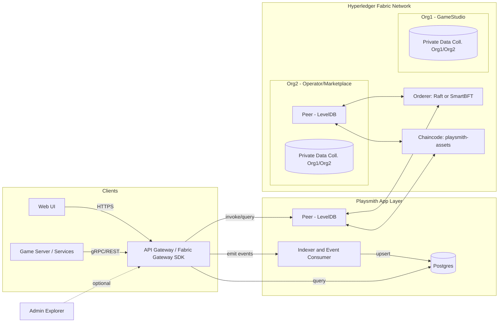

# Playsmith

基于 Hyperledger Fabric 的许可制高性能区块链栈，用于游戏资产铸造、交易与查询。

English version: [README.md](README.md)

目标
- 游戏资产上链：可替代/半同质/非同质（ERC-1155 风格）资产铸造、转移、上架、成交
- Web 页面查询：提供浏览/检索与资产详情页，事件驱动的索引
- 游戏友好接口：面向游戏服的 REST/gRPC SDK 与批量接口
- 高性能：秒级终局、百到千级 TPS 的稳态吞吐；按键空间设计避免热点冲突

## 架构（Mermaid 图）

说明
- API Gateway：对外暴露 REST/gRPC；内部通过 Fabric Gateway SDK 调用链码；统一鉴权、限流与批量。
- Indexer：订阅链码事件，生成可检索视图存入 Postgres（供 Web/UI 与统计用）；避免对账本做昂贵富查询。
- Fabric：2 组织 1 通道；Raft/SmartBFT 排序；Peer 使用 LevelDB（高吞吐）；敏感字段（价格/对手/履约证据）可放私有数据集合。

## 账本与链码设计（1155 风格）
键空间（复合键，避免热点）
- `bal~tokenId~owner -> uint64`：余额
- `meta~tokenId -> {uri, creator, supplyCap...}`：元数据
- `op~owner~operator -> bool`：授权（可选）
- `ask~tokenId~seller~listingId -> {amount, price, ts}`：卖单（价格可改为私有数据）

主要交易
- `Mint(tokenId, to, uri, amount)`：`role=MINTER` 才能铸造；首次写入 `meta`
- `Transfer(tokenId, from, to, amount)`：检查授权与余额，原子增减 `bal`
- `ListForSale(tokenId, seller, amount, price)`：写入 `ask`；生产可用私有集合存价格
- `Buy(tokenId, seller, listingId, buyer, amount)`：原子转移并删除 `ask`

并发与性能
- 交易只触及极少量键（卖家/买家余额 + 卖单），降低 MVCC 冲突概率
- 避免全局计数器；`listingId` 使用 TxID 或服务端生成的 UUID

## API 设计（对游戏友好）
鉴权
- 支持两种模型：
  - 平台托管：平台给游戏服签发 JWT（后台绑定 Fabric 身份）
  - 自持证书：游戏服使用 Fabric CA 颁发的 X.509 证书，通过 Gateway 直连

实现（`internal/auth`）
- 平台托管（HS256）：`POST /api/v1/auth/token`（带 `X-Issue-Secret`）签发 JWT；REST 与 gRPC 均要求 `Authorization: Bearer <jwt>`
- 按操作授权：所有已鉴权调用要求 JWT 携带非空 `mspId` 与 `role`；`Mint`/`BatchMint` 要求 `role=MINTER`（网关层把关，与链码 `requireMinter` 同规则；`internal/auth/authorize.go`）
- 网关 Fabric 身份：`FABRIC_CERT_PATH`/`FABRIC_KEY_PATH`/`FABRIC_MSP_ID` 配置网关进程提交交易所用的 X.509 身份（当前所有调用共用同一身份，按 subject 的身份隔离待做，见 todo.md）；JWT 未启用时 REST 保持开放（开发模式）
- 传输安全：设 `TLS_CERT_PATH`/`TLS_KEY_PATH`（PEM 证书/私钥）时，REST 与 gRPC 均以 TLS 提供服务；未配置时回退明文（仅限开发）

REST（已实现端点；字段详见 docs/SPEC.md API Mapping）
- `POST /api/v1/assets/mint` body: `{tokenId, to, uri, amount}`（JWT 需 `role=MINTER`）
- `POST /api/v1/assets/batchMint` body: `{ids, tos, amounts, uris}`（JWT 需 `role=MINTER`）
- `POST /api/v1/assets/transfer` body: `{tokenId, from, to, amount}`
- `POST /api/v1/assets/batchTransfer` body: `{ids, from, to, amounts}`
- `POST /api/v1/assets/approveAll` body: `{owner, operator, approved}`
- `GET /api/v1/assets/:tokenId/balance/:owner`、`/:tokenId/uri`、`/:tokenId/exists`、`/:tokenId/totalSupply`
- `POST /api/v1/market/list` body: `{tokenId, seller, amount, price}`
- `POST /api/v1/market/list-private` body: `{tokenId, seller, amount, price}`（price 经 transient 传递）
- `POST /api/v1/market/cancel` body: `{tokenId, seller, listingId}`
- `POST /api/v1/market/buy` body: `{tokenId, seller, listingId, buyer, amount}`
- 卖单/成交检索查询（listings）为规划项：基于 Indexer 的 Postgres 投影，查询 API 与 Web UI 一并待实现

gRPC（可选）
- 同名服务定义，返回交易结果与 `tx_id`（链上交易标识，即使链码无返回值也可追踪）；更低开销，适合高并发后台。区块号与事件回执为规划项，当前 proto 响应仅含 `tx_id`/`result`。
- 启用：设 `GRPC_PORT`（并设 `JWT_SECRET`，否则拒绝启动）；proto 见 `proto/playsmith/v1/gateway.proto`

Web UI
- 浏览合约事件、资产余额、最近成交与卖单；查询来自 Postgres 的索引视图。

## 快速开始（开发环境）
前置
- Docker & Docker Compose、Node.js 或 Go、Fabric v2.5+ 二进制
- 克隆 `hyperledger/fabric-samples`（网络脚本）

步骤（使用 test-network）
1) 启动 2 组织 1 通道
   - `cd fabric-samples/test-network`
   - `./network.sh up createChannel -c playsmith -ca`  # 开发用；生产建议 LevelDB（默认）
2) 部署链码
   - `./network.sh deployCC -c playsmith -ccn playsmith-assets -ccl go -ccp ../../Playsmith/chaincode/playsmith-assets`
3) 启动应用层
   - API：`cmd/api`（Go；设置 `FABRIC_GATEWAY_ENDPOINT` 等环境变量时使用真实 Fabric Gateway 客户端，否则回退 `NoopClient` 开发模式）
   - 鉴权：`JWT_SECRET`（≥32 字节）启用 JWT；`POST /api/v1/auth/token` 需 `X-Issue-Secret` 与 `JWT_SECRET` 相同；gRPC 端口 `GRPC_PORT`
   - Indexer：`cmd/indexer`（订阅链码事件并 upsert 到 Postgres；需 `POSTGRES_DSN` 与 Fabric 环境变量）
   - Web UI：`web/`（当前为占位；查询页待实现）
4) 构建与测试
   - `make build` / `make test`（均先跑 `proto-check` 生成物禁改守卫）；再生成 `make proto`（protoc 版本钉在 Makefile，`make proto-install` 安装插件并校验工具链）

参考目录
- `chaincode/playsmith-assets/`：链码（Go，已实现 Mint/Transfer/Batch/List/Buy/Cancel/approvals/supply/private price）
- `cmd/api/`：API Gateway（REST + 批量；JWT 鉴权与 gRPC 已实现）
- `cmd/indexer/`：事件订阅与入库（Fabric Gateway 事件 + Postgres）
- `internal/sdk/`：Fabric SDK 封装（`Client` 接口 + `NoopClient` 开发占位 + `GatewayClient` 真实实现）
- `web/`：前端（查询页，占位）
- `deploy/`：本地一键脚本与 Docker 组合

## 性能与调优
Fabric 层
- Orderer：`BatchTimeout=0.5-1s`、`MaxMessageCount=200-500`、`AbsoluteMaxBytes/PreferredMaxBytes` 视网络带宽调整
- Peer：并行背书开启；GOMAXPROCS 与连接池调大；LevelDB > CouchDB（若无需富查询）
- 链码：避免热点键；读写集最小化；尽量使用复合键前缀扫描代替富查询

应用层
- 批量提交（客户端/网关聚合）与幂等重试（以 TxID 去重）
- Indexer 异步化重建视图，Web 查询不触发账本昂贵扫描
- gRPC 低延迟管道替代 REST（可选）

目标（保守）
- 简单转移/成交路径：200-800 TPS（2-4 节点，1s 批量切块，LevelDB）
- 秒级终局：端到端常见 0.8-2.5s（视批量与背书）

## 权限与隐私
- 组织身份（MSP/CA）；铸造检查证书属性 `role=MINTER`；operator 授权走链上 `op~owner~operator` 状态，不使用证书属性
- 背书策略：`AND('Org1.peer','Org2.peer')`；资产级 SBE 可进一步加严
- 私有数据集合：价格、对手、结算明细仅 Org1/Org2 可见；链上存哈希校验

## 路线图
- [x] 链码 v0：Mint/Transfer/List/Buy + 事件（另含 BatchMint/BatchTransfer/approvals/supply/私有价格上架；鉴权校验已实现，见 docs/SPEC.md）
- [x] API Gateway（REST + 批量；Fabric 调用可切换真实 `GatewayClient`，默认 `NoopClient` 开发模式）
- [x] API Gateway：JWT 鉴权与 gRPC
- [x] Indexer（订阅 Fabric 事件）+ Postgres schema
- [x] Fabric Gateway SDK 接入（替换 `internal/sdk` 的 NoopClient）
- [ ] Web UI（资产/卖单/成交）
- [ ] 压测脚本（Caliper/自研）与调优模板
- [x] `playsmithPvt` 集合的 collections 配置文件（`deploy/collections.json`）
- [ ] SBE（资产级背书策略）样例

## 许可
本项目遵循本仓库 LICENSE。
